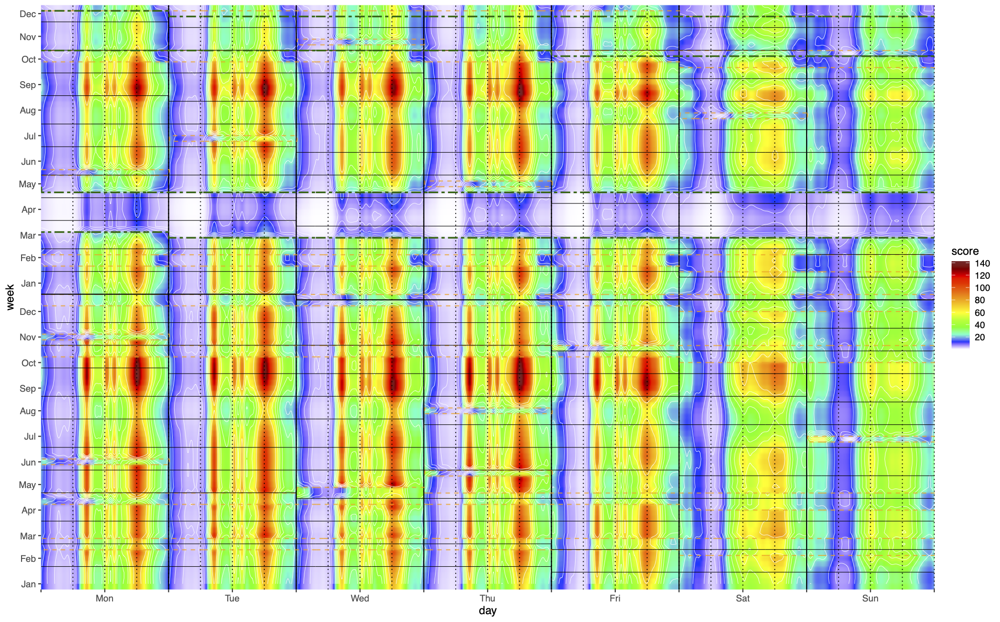

# Alix Rigal — Mathématiques appliquées, statistique et R&D

> **Portfolio scientifique · Modélisation statistique · Données environnementales et industrielles**

Docteur en mathématiques appliquées, spécialisé en modélisation statistique, je conçois et mets en œuvre des approches quantitatives pour analyser des données complexes, caractériser les incertitudes et répondre à des problématiques scientifiques ou industrielles.

Mon parcours associe recherche académique, projets de R&D, conseil statistique et enseignement supérieur.

### Ressources et contact : {#ressources-et-contact}

-   **CV :** [R&D](assets/CV__Spontane_IR.pdf), [Enseignement](assets/CV_Spontané_Enseignement.pdf)
-   **Portefeuille de compétences :** [Consulter (PDF)](assets/portefeuille2competences.pdf)
-   **Contact :** [[alix.rigal\@transverselab.com](mailto:alix.rigal@transverselab.com){.email}]
-   **Portfolio scientifique en ligne :** [version évolutive](https://galaxilir.github.io/Portfolio/)

------------------------------------------------------------------------

## Vue d’ensemble {#vue-densemble-profil-scientifique}

-   **Positionnement :** ingénierie R&D en modélisation statistique appliquée, avec une spécialisation dans les données environnementales ou industrielles.
-   **Modélisation statistique** : méthodes paramétriques et non paramétriques, régression quantile, lissage par splines, analyse de séries temporelles et quantification de l’incertitude.
-   **Recherche :** doctorat en mathématiques appliquées consacré à la modélisation statistique d'un climat non stationnaire, complété par des travaux en environnement et en mobilité. Intérêt pour les méthodes statistiques, notamment les modèles additifs généralisés (GAM), ainsi que pour les fondements théoriques de la statistique, en particulier la géométrie de l’information.
-   **R&D et conseil :** cofondateur de TransverseLab ; missions portant notamment sur l’incertitude, les plans d’expérience et la reconstruction de séries temporelles.
-   **Enseignement :** plus de 250 heures d’enseignement en mathématiques appliquées, probabilités, statistique et analyse de données.
-   **Outils principaux :** R, Python, Matlab, Bash, LaTeX et outils de traitement de données scientifiques.
-   **Traitement d’images 2D/3D :** traitement et segmentation d’images scientifiques avec Fiji/ImageJ et Python, notamment pour l’analyse de données 3D multiphasées, l’extraction de mesures géométriques et la mobilisation de méthodes d’apprentissage automatique.

## Parcours professionnel et scientifique {#parcours-professionnel-et-scientifique}

### TransverseLab — Cofondateur et statisticien

*2022 – aujourd’hui*

-   Modélisation statistique avancée et développement de pipelines reproductibles en R, Python et Matlab.
-   Projets portant notamment sur les plans d’expérience, la quantification d’incertitude, l’analyse de protocoles et la reconstruction de séries temporelles environnementales.
-   Contribution au pilotage scientifique et technique, aux échanges avec les clients et à la gestion de projets.
-   Participation à la prospection, aux propositions commerciales et au suivi administratif des missions.

### Postdoctorat — LISST

*2021 – 2022*

-   Étude de l’impact de la crise sanitaire sur la mobilité urbaine à partir de données de vélos en libre-service.
-   Analyse d’un jeu de données couvrant environ 700 stations, à une résolution temporelle de la minute sur deux ans.
-   Utilisation de méthodes de séries temporelles, de modèles additifs généralisés (GAM) et d’analyse factorielle.

### Doctorat en mathématiques appliquées — CNRM / Université de Toulouse

*2016 – 2020*

-   Étude de la déformation du cycle saisonnier dans un climat non stationnaire.
-   Développement de méthodes de modélisation non paramétrique, notamment à base de splines et de méthodes de lissage.
-   Travaux sur l’estimation de normales climatologiques quotidiennes dans un climat changeant.

*Figure — Comparaison de différentes estimations des normales climatologiques annuelles de température à Paris.*

### Enseignement supérieur — ENAC et École nationale de la météorologie

-   Plus de 250 heures d’enseignement.
-   Probabilités, statistique, estimation et tests.
-   Variables climatiques, statistique saisonnière et analyse de données météorologiques avec R.
-   Analyse en composantes principales (ACP) et méthodes de classification.

## Compétences {#compétences}

### Modélisation statistique

-   Modèles additifs généralisés (GAM) et régressions quantiles.
-   Splines de lissage, méthodes à noyaux et méthodes non paramétriques.
-   Séries temporelles et analyse factorielle.
-   Bootstrap, validation croisée, sélection de modèles et estimation d’hyperparamètres.
-   Géostatistique et krigeage.
-   Quantification d’incertitude et plans d’expérience.
-   Estimation statistique, tests d’hypothèses et inférence.

### Données environnementales et industrielles

-   Analyse de données climatiques et météorologiques.
-   Données spatio-temporelles, pollution et mobilité.
-   Reconstruction de séries temporelles à partir de variables explicatives.
-   Analyse et interprétation de données expérimentales.
-   Étude de protocoles et comparaison de stratégies de mesure.

### Programmation scientifique et reproductibilité

-   **R :** expertise en analyse statistique et développement de scripts.
-   **Python, Matlab, Scilab :** analyse et traitement de données.
-   **Bash, LaTeX, CDO :** outils de calcul scientifique, rédaction et traitement de données.
-   **R Markdown et Jupyter :** supports et analyses reproductibles, selon les projets.
-   **Git et GitHub :** gestion de versions et publication de projets scientifiques.

### Imagerie scientifique 3D

Travail récent sur des données d’images 3D représentant plusieurs phases : solide, huile, eau et air.

-   Traitement d’images avec **Fiji/ImageJ**.
-   Développement de macros ImageJ au format `.ijm`.
-   Mesure de propriétés géométriques et de volumes à partir d’images 3D.
-   Utilisation de **Python** et exploration de méthodes d’apprentissage automatique, notamment les forêts aléatoires et SAM 2.

### Apprentissage automatique

-   Connaissances théoriques sur les réseaux de neurones convolutifs et récurrents, les LSTM, les autoencodeurs, les GAN et les Transformers.
-   Démonstrateur personnel en cours de développement (hors missions). \## Projets scientifiques et R&D {#projets-scientifiques-et-rd}

### 1. Estimation de normales climatologiques dans un climat changeant

**Problématique :** estimer des normales climatologiques quotidiennes lorsque le climat évolue et que l’hypothèse de stationnarité doit être remise en question.

**Approches :**

-   Modélisation non paramétrique.
-   Méthodes de lissage et splines.
-   Analyse statistique de données climatiques.

**Publication associée :** *Climate Dynamics* (2019), « [Estimating daily climatological normals in a changing climate](https://link.springer.com/article/10.1007/s00382-018-4584-6) » Rigal A., Azaïs J.-M., Ribes A. (2019).

### 2. Analyse de la mobilité urbaine

**Problématique :** caractériser les évolutions de la mobilité à partir de données de vélos en libre-service.

**Données :** environ 700 stations, avec une résolution temporelle de la minute sur deux ans. 

*Figure : intensité moyenne estimée des départs de vélos en libre-service à Toulouse (par tranche de 5 minutes) sur 2019-2020, avant et après le confinement. L'abscisse représente le jour de la semaine et l'heure de la journée, l'ordonnée la période de l'année (numéro de semaine et mois). L'estimation repose sur un modèle additif généralisé (GAM) qui prend en compte l'effet des jours particuliers (confinement, jours fériés). Le processus de comptage est modélisé par une loi binomiale négative, afin de tenir compte d'une variance qui dépend de la moyenne.*

**Méthodes :**

-   Analyse de séries temporelles.
-   Modèles additifs généralisés (GAM).
-   Analyse factorielle.

**Publication associée :**

**2021 — arXiv.** [Impact of the COVID-19 pandemic on bike-sharing uses in two French towns](https://arxiv.org/abs/2206.06286) Furno A., Jouve B., Revelli B., Rigal A. et al. (2021)

### 3. Plans d’expérience et quantification d’incertitude

Missions de R&D appliquée portant notamment sur la comparaison de protocoles, l’analyse de données expérimentales et la caractérisation de l’incertitude.

### 4. Reconstruction de séries temporelles environnementales

Travail de modélisation visant à reconstruire des séries temporelles de paramètres chimiques à partir de variables explicatives, dans le cadre d’une mission appliquée pour un acteur de l’environnement.

### 5. Traitement d’images 3D multiphasées

**Objectif :** extraire des mesures géométriques et des volumes à partir de données d’images 3D représentant plusieurs phases : solide, huile, eau et air.

**Outils et méthodes utilisés ou mobilisés :**

-   Fiji/ImageJ et macros `.ijm`.
-   Python.
-   Forêts aléatoires.
-   SAM 2.

## Publications {#publications}

-   **2019 — *Climate Dynamics*.** « [Estimating daily climatological normals in a changing climate](https://hal.science/hal-01980565/document) » Rigal A., Azaïs J.-M., Ribes A. (2019). ([poster EGU](https://presentations.copernicus.org/EGU2018/EGU2018-19319_presentation.pdf) )
-   **2021 — arXiv.** [Impact of the COVID-19 pandemic on bike-sharing uses in two French towns](https://arxiv.org/abs/2206.06286)

## Enseignement et communication scientifique {#enseignement-et-communication-scientifique}

-   Plus de 250 heures d’enseignement en mathématiques appliquées, probabilités, statistique et analyse de données.
-   Présentations scientifiques et participation à des collectifs scientifiques, notamment BiblioStat et Géo-Maître.
-   Français : langue maternelle.
-   Anglais : courant.

## À propos de ce dépôt {#à-propos-de-ce-dépôt}

Ce dépôt constitue mon portfolio scientifique et professionnel. Il présente une sélection de travaux, de méthodes statistiques, de projets de R&D et de publications illustrant mon parcours en mathématiques appliquées, modélisation statistique et analyse de données. Pour des raisons de confidentialité, les jeux de données présentés dans certaines démonstrations ont été modifiés à des fins d’illustration méthodologique. Ils ne correspondent pas aux données réelles utilisées dans le cadre des missions contractuelles. Les exemples publiés visent à illustrer les méthodes d’analyse et de modélisation, sans divulguer les données confidentielles ni, le cas échéant, l’identité des partenaires.

## Navigation

-   [Vue d’ensemble](#vue-densemble-profil-scientifique)
-   [Parcours professionnel et scientifique](#parcours-professionnel-et-scientifique)
-   [Compétences](#compétences)
-   [Projets scientifiques et R&D](#projets-scientifiques-et-rd)
-   [Publications](#publications)
-   [Enseignement et communication scientifique](#enseignement-et-communication-scientifique)
-   [À propos de ce dépôt](#à-propos-de-ce-dépôt)
-   [Ressources et contact](#ressources-et-contact)

<!-- Commentaire interne  -->
